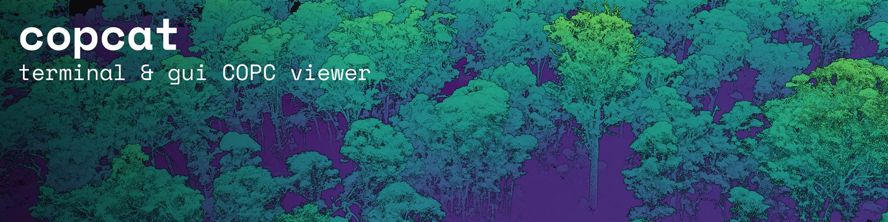

# Copcat

A viewer for [COPC](https://copc.io/) LiDAR point clouds, local or streamed over HTTP.

## Install

Prebuilt binaries are available for Windows x64 and Linux x64. You don't need Rust.

Windows (PowerShell):

```powershell
powershell -ExecutionPolicy Bypass -c "irm https://github.com/UTAS-TerraLuma/copcat/releases/latest/download/copcat-installer.ps1 | iex"
```

Linux:

```sh
curl --proto '=https' --tlsv1.2 -LsSf https://github.com/UTAS-TerraLuma/copcat/releases/latest/download/copcat-installer.sh | sh
```

This installs `copcat`, `copcat-viewer` and `copcat-update` into `~/.local/bin`
(`%USERPROFILE%\.local\bin` on Windows), or `$XDG_BIN_HOME` if it's set, and adds that
folder to `PATH`. Open a new terminal afterwards.

The Windows binaries aren't code signed, so the first time `copcat-viewer.exe` runs,
SmartScreen may show "Windows protected your PC". Click "More info", then "Run anyway".

## Update

```sh
copcat update
```

Running the installer again also installs the latest release over the old one.

## Usage

Open a file or a URL in a new viewer window:

```sh
copcat open path/to/cloud.copc.laz
copcat open https://example.com/cloud.copc.laz
```

You can also start `copcat-viewer` on its own and paste a path or URL into it.

## Saving images

In the viewer, click **Save PNG…** under **Save image** in the Point cloud window. By
default the image is the size of the 3D view. Untick **Match view** to choose a size:
the view then darkens whatever falls outside the image. The image is rendered once
the detail for its size has loaded, so an image bigger than the window gets more
detail, not a stretched screenshot.

`copcat render` does the same without a window:

```sh
copcat render path/to/cloud.copc.laz -o view.png --width 3840 --height 2160 --view top
```

To render the view you're looking at, click **Copy as command** in the viewer and
paste the command it copies. Run `copcat render --help` for the camera and style
options.

## Using it from WSL

In WSL, install the Windows build rather than the Linux one. The Linux build works under
WSL, but its graphics run through WSLg and are much slower.

WSL can run Windows programs, so after installing on the Windows side, call
`copcat.exe` from your WSL terminal. A Windows program can't read Linux paths like
`/home/you/...`, so convert them with `wslpath -w`:

```sh
copcat.exe open "$(wslpath -w ~/data/cloud.copc.laz)"
```

Relative paths work without converting, because the Windows program starts in the same
folder:

```sh
cd ~/data && copcat.exe open cloud.copc.laz
```

To just type `copcat`, add this to your `~/.bashrc`:

```sh
copcat() {
  if [ "$1" = open ] && [ -e "$2" ]; then
    copcat.exe open "$(wslpath -w "$2")"
  else
    copcat.exe "$@"
  fi
}
```

Windows reads files in WSL more slowly than files on its own drives. If large clouds
load slowly, move them under `/mnt/c/` (the Windows `C:` drive).

To update from WSL, run `copcat.exe update` (or `copcat update` with the function above).

## Building from source

```sh
cargo run --release -- path/to/cloud.copc.laz
```

See [docs/releasing.md](docs/releasing.md) for how releases are made.
