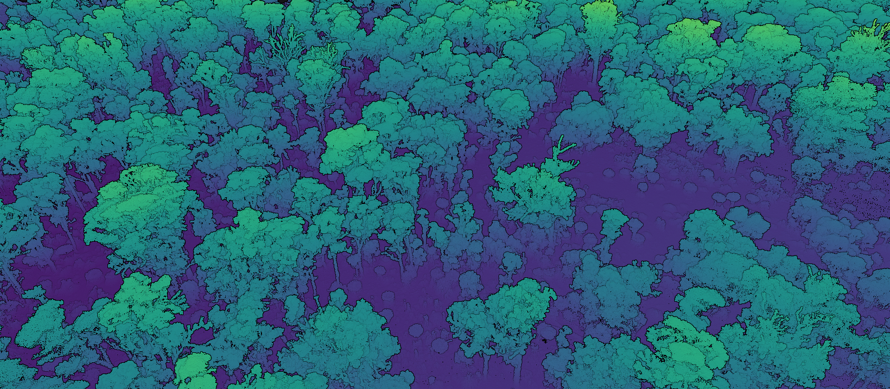

# Copcat

A viewer for [COPC](https://copc.io/) LiDAR point clouds, local or streamed over HTTP.

## Install

Prebuilt binaries are available for Windows x64 and Linux x64. You don't need Rust.

Windows (PowerShell):

```powershell
powershell -ExecutionPolicy Bypass -c "irm https://github.com/UTAS-TerraLuma/copcat/releases/latest/download/copcat-installer.ps1 | iex"
```

Linux:

```sh
curl --proto '=https' --tlsv1.2 -LsSf https://github.com/UTAS-TerraLuma/copcat/releases/latest/download/copcat-installer.sh | sh
```

This installs `copcat`, `copcat-viewer` and `copcat-update` into `~/.local/bin`
(`%USERPROFILE%\.local\bin` on Windows), or `$XDG_BIN_HOME` if it's set, and adds that
folder to `PATH`. Open a new terminal afterwards.

The Windows binaries aren't code signed, so the first time `copcat-viewer.exe` runs,
SmartScreen may show "Windows protected your PC". Click "More info", then "Run anyway".

## Update

```sh
copcat update
```

Running the installer again also installs the latest release over the old one.

## Usage

Open a file or a URL in a new viewer window:

```sh
copcat open path/to/cloud.copc.laz
copcat open https://example.com/cloud.copc.laz
```

You can also start `copcat-viewer` on its own and use **Open…** in its toolbar to
choose a file (Ctrl+O) or type a URL (Ctrl+L), or press Ctrl+P to browse a STAC
catalog or a folder of clouds (see [Data sources](#data-sources)).

## Elevation and height above ground

A cloud can hold two heights: elevation, and height above ground (a normalised
cloud). Either one can be in Z, and the other in an extra dimension. Copcat works
out which is where from the extra dimensions' names:

- An extra dimension named like `HeightAboveGround` or `HAG` is height above ground,
  and Z is elevation.
- An extra dimension named like `Elevation`, `Altitude` or `Z_orig`, with none
  named like height above ground, is elevation, and Z is height above ground.
- Otherwise Z is elevation.

Under **Heights** in the Point cloud window, **Draw at** switches between the two.
The cloud opens at whichever height is in Z. Under **Sources** you can say where
each height is, and then click **Reload with these**. On the command line, use
`--elevation` and `--hag`. Each takes `z`, the name of an extra dimension, or
`none`:

```sh
copcat open cloud.copc.laz --hag z --elevation Elevation
copcat render cloud.copc.laz -o canopy.png --z hag
```

`copcat render --z` picks the height to draw at.

The octree is built on Z. So when you draw at a height in an extra dimension, Copcat
estimates each node's vertical extent from the nodes loaded so far. It may load
somewhat more than it needs.

## Saving images

In the viewer, click **Save PNG…** under **Save image** in the Point cloud window. By
default the image is the size of the 3D view. Untick **Match view** to choose a size:
the view then darkens whatever falls outside the image. The image is rendered once
the detail for its size has loaded, so an image bigger than the window gets more
detail, not a stretched screenshot.

`copcat render` does the same without a window:

```sh
copcat render path/to/cloud.copc.laz -o view.png --width 3840 --height 2160 --view top
```

To render the view you're looking at, click **Copy as command** in the viewer and
paste the command it copies. Run `copcat render --help` for the camera and style
options.

## Settings

The viewer reads its settings from JSON files, as VS Code and Zed do:

| File | Where |
| --- | --- |
| User settings | `~/.copcat/settings.json` (`%USERPROFILE%\.copcat\settings.json` on Windows) |
| Workspace settings | `.copcat/settings.json` in the folder you start Copcat in |

Settings are layered: the built-in defaults, then the user file, then the workspace
file. Every key is optional, so a file only needs what it changes, and a later layer
overrides an earlier one key by key at every depth: a workspace file that sets only
`display.edl.radius` keeps the user file's `display.edl.strength`. `keybindings`
combine by command. Connectors combine by `name`: a workspace connector named like a
user one replaces it, and the rest are added after the user's.

Comments (`//`, `/* */`) and trailing commas are allowed. A file that isn't valid JSON
is skipped; an unknown key or a value of the wrong type is skipped; a number outside
what the UI's field allows is clamped. Each problem shows in a bar at the foot of
the window (and on stderr), naming the file, and the rest of the settings still
apply.

Every key, with its default:

```jsonc
{
  "theme": "graphite",              // the only theme so far
  "display": {
    "colorMode": "rgb",             // "height", "rgb" or "classification"
    "pointSizeMode": "fixed",       // or "adaptive"; see below
    "fill": 1.5,                    // adaptive: size per point spacing, 0.5 to 4
    "minPointSize": 1.0,            // adaptive: smallest, 0.5 to 8 (logical pixels)
    "maxPointSize": 20.0,           // adaptive: largest, 2 to 64 (logical pixels)
    "pointSize": 2.0,               // fixed: 1 to 10 (logical pixels)
    "edl": {                        // eye-dome lighting
      "enabled": true,
      "strength": 1.0,              // 0.1 to 5
      "radius": 1.4                 // 1 to 4 (pixels)
    },
    "projection": "perspective"     // or "orthographic"
  },
  "performance": {
    "pointBudget": 5000000,         // 500000 to 30000000
    "spacingPx": 2.0                // 0.5 to 20
  },
  "export": {                       // Save image
    "matchView": true,              // image size follows the 3D view
    "width": 1920,                  // 1 to 16384, when matchView is false
    "height": 1080
  },
  "keybindings": {
    "view.top": "7",
    "view.reset": "Ctrl+R",
    "view.bottom": null             // null or "" removes a shortcut
  },
  "connectors": {
    "stac": [
      { "name": "NatureScan", "url": "https://stacapi.naturescan.earth/" }
    ],
    "folders": [
      { "name": "My project", "path": "D:/data/project" }
    ]
  }
}
```

Points are drawn `pointSize` pixels across by default. `"pointSizeMode": "adaptive"`
draws each point `fill` times its spacing on screen instead, between `minPointSize`
and `maxPointSize` (a `maxPointSize` below `minPointSize` is raised to it). Only
`pointSizeMode` picks the mode: a file that sets `fill` or `pointSize` without it
keeps the mode it had (fixed, unless an earlier file chose adaptive), and the other
mode's settings wait to be used in that mode.

A shortcut is modifiers and a key joined by `+`, in any case: `Ctrl+Shift+P`, `F5`,
`Alt+Up`, `Ctrl++`. `Ctrl` means Cmd on a Mac. Keys are egui's names: letters,
digits, `F1` to `F35`, `Up`, `PageDown`, `Escape`, `Space`, `Minus` and so on.
Giving a command a shortcut another command has takes it from that command. The
commands are:

| Id | Command | Default |
| --- | --- | --- |
| `file.open` | Open file… | Ctrl+O |
| `file.open_url` | Open URL… | Ctrl+L |
| `mode.explore`, `mode.subcloud` | Explore or Subcloud mode | |
| `subcloud.tool_line`, `subcloud.tool_circle`, `subcloud.tool_square` | Draw a line, circle or square subcloud | |
| `subcloud.cancel_tool` | Cancel the subcloud tool | Esc while a tool is picked |
| `view.top`, `view.bottom` | View from top, bottom | 7, Ctrl+7 |
| `view.front`, `view.back` | View from front, back | 1, Ctrl+1 |
| `view.right`, `view.left` | View from right, left | 3, Ctrl+3 |
| `view.perspective`, `view.orthographic` | Set the projection | |
| `view.toggle_projection` | Toggle perspective / orthographic | 5 |
| `view.reset` | Reset view | |
| `view.toggle_diagnostics` | Toggle diagnostics | Ctrl+Shift+D |
| `palette.commands` | Show all commands (the command palette) | Ctrl+Shift+P |
| `palette.open` | Quick open a source | Ctrl+P |
| `display.toggle_edl` | Toggle eye-dome lighting | |
| `display.color_height`, `display.color_rgb`, `display.color_class` | Colour by height, RGB, classification | |
| `export.save_image` | Save image… | Ctrl+S |
| `export.copy_command` | Copy render command | |
| `settings.open_user` | Open user settings | |
| `settings.open_workspace` | Open workspace settings | |
| `settings.reload` | Reload settings | |
| `settings.save_display_defaults` | Save current display settings as defaults | |
| `sources.add_stac` | Add STAC source… | |
| `sources.add_folder` | Add folder source… | |
| `sources.remove` | Remove data source… | |

Connectors are places to open clouds from: STAC catalogs and APIs (`url`, `http` or
`https`) and folders (`path`). A relative folder path is relative to the folder holding
the `.copcat` directory that declares it, so `"path": "."` in a workspace file is the
workspace. Each needs a `name`. See [Data sources](#data-sources) for browsing them.

The files are the source of truth: changing a setting in the window lasts until you
close it. The settings commands (in the command palette, or bound to a shortcut):

- **Open user settings** and **Open workspace settings** create the file with a
  commented template if it's missing, and open it in your editor for `.json` files.
- **Reload settings** reads the files again and applies them.
- **Save current display settings as defaults** writes the display and performance
  settings (colour, point size mode, fill, smallest and largest adaptive sizes, fixed
  point size, eye-dome lighting, projection, point budget and spacing) into the user
  file, keeping its other keys. The file is rewritten as plain
  JSON, so its comments are lost.

`COPCAT_CONFIG_DIR` moves the user settings directory (from `~/.copcat`), and
`COPCAT_WORKSPACE` sets the workspace folder (from the current directory).
`copcat render` doesn't read settings files: its output depends only on its
arguments.

## Data sources

Data sources (connectors) let you browse to a cloud without leaving the viewer. Press
Ctrl+P (quick open): each source is listed by name, marked **STAC source** or
**Folder source**. Choose one to browse into it, type to filter, and press Enter on a
cloud to open it. Esc, or Backspace in an empty field, goes back up a level. The
**Open…** menu lists the sources too, and opens quick open at the one you pick.

- **STAC sources** browse a [STAC](https://stacspec.org) catalog: its catalogs and
  collections, then their items, showing each item's title and date. Choosing an item
  opens its COPC point cloud (an asset of type `application/vnd.laszip+copc`, or
  whose file ends `.copc.laz`); an item with several lists them to choose from. Items
  without one are greyed out. Assets must be at `http` or `https` URLs; `s3://` links
  are shown but can't be opened yet.

  Both kinds of STAC work: a *static catalog* (JSON files linked to each other, such
  as on an object store; give the URL of its `catalog.json`, or of the folder it's in)
  and a *STAC API* (give its landing page). An API's items are fetched 50 at a time:
  choose **Load more…** at the foot of the list for the next page. A static catalog's
  item files are fetched 24 at a time in the same way.
- **Folder sources** list every COPC file (`*.copc.laz`) under a folder, searched on
  a background thread. Hidden folders (starting with `.`), `target`, `node_modules`
  and links to folders are skipped, and the search stops at 16 folders deep, 2000
  files listed (the rest are counted) and 200000 entries looked at.
- **Workspace**: the folder you start Copcat in (or `COPCAT_WORKSPACE`) is always
  offered as a folder source named "Workspace: *folder name*", without any settings,
  unless it's your home folder or a drive or filesystem root, which would take too
  long to search.

What's been fetched is kept until you close the viewer, so going back is instant;
choose **Refresh** at the foot of a list to fetch it again. No signing in is
supported yet: a catalog that needs it shows the server's refusal.

Add and remove sources from the command palette (Ctrl+Shift+P), or from the
**Open…** menu. These change your user settings file, keeping its other keys (it's
rewritten as plain JSON, so comments are lost), and take effect at once:

- **Add STAC source…** asks for the catalog's URL, checks it's a STAC catalog, then
  asks for a name, offering the catalog's title (or the URL's host) as the default.
- **Add folder source…** asks for a folder, then a name, offering the folder's name.
- **Remove data source…** lists the sources in the user settings file to remove one.
  Sources declared in a workspace file are shown but must be removed from that file.

Or write them in a settings file:

```jsonc
"connectors": {
  "stac": [
    { "name": "NatureScan", "url": "https://stacapi.naturescan.earth/" },
    { "name": "AEO workshop", "url": "https://example.com/stac/catalog.json" }
  ],
  "folders": [{ "name": "Surveys", "path": "D:/data/surveys" }]
}
```

## Using it from WSL

In WSL, install the Windows build rather than the Linux one. The Linux build works under
WSL, but its graphics run through WSLg and are much slower.

WSL can run Windows programs, so after installing on the Windows side, call
`copcat.exe` from your WSL terminal. A Windows program can't read Linux paths like
`/home/you/...`, so convert them with `wslpath -w`:

```sh
copcat.exe open "$(wslpath -w ~/data/cloud.copc.laz)"
```

Relative paths work without converting, because the Windows program starts in the same
folder:

```sh
cd ~/data && copcat.exe open cloud.copc.laz
```

To just type `copcat`, add this to your `~/.bashrc`:

```sh
copcat() {
  if [ "$1" = open ] && [ -e "$2" ]; then
    copcat.exe open "$(wslpath -w "$2")"
  else
    copcat.exe "$@"
  fi
}
```

Windows reads files in WSL more slowly than files on its own drives. If large clouds
load slowly, move them under `/mnt/c/` (the Windows `C:` drive).

To update from WSL, run `copcat.exe update` (or `copcat update` with the function above).

## Building from source

```sh
cargo run --release -- path/to/cloud.copc.laz
```

See [docs/releasing.md](docs/releasing.md) for how releases are made.

## Fonts

The viewer has two fonts built in: [Inter](https://github.com/rsms/inter) and
[JetBrains Mono](https://github.com/JetBrains/JetBrainsMono). Both are under the SIL Open
Font License 1.1; see [assets/fonts](assets/fonts) for their licences.
